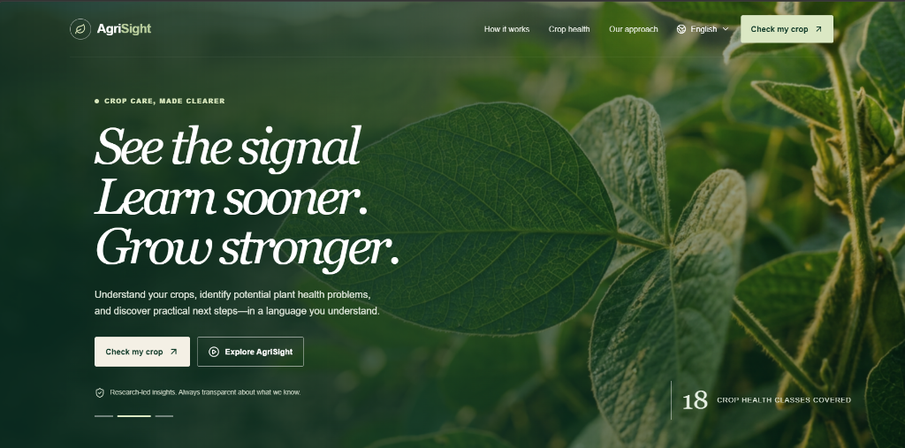
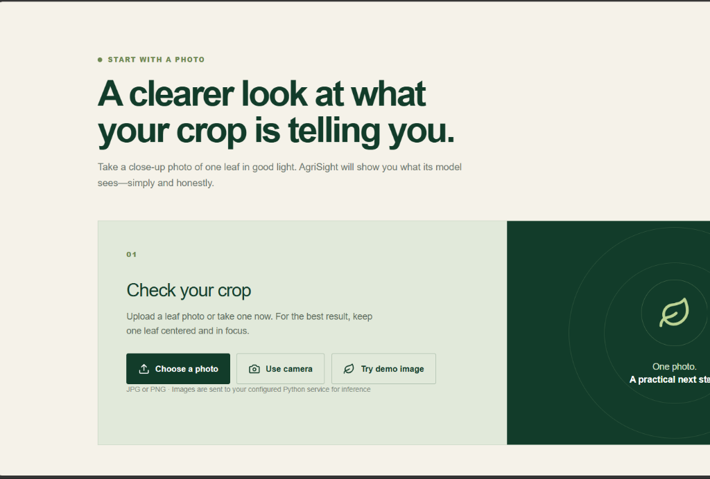
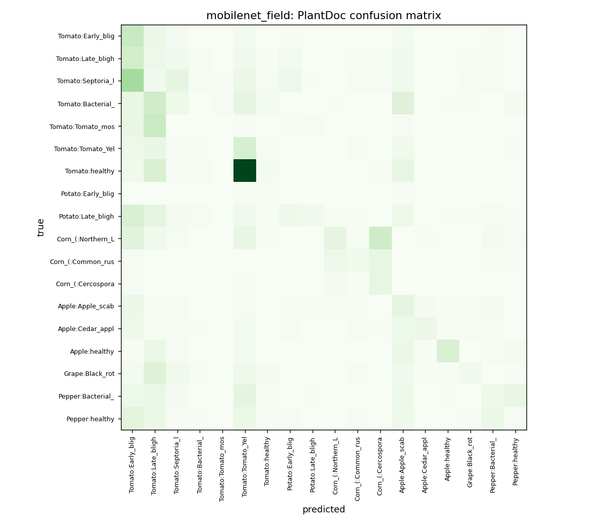
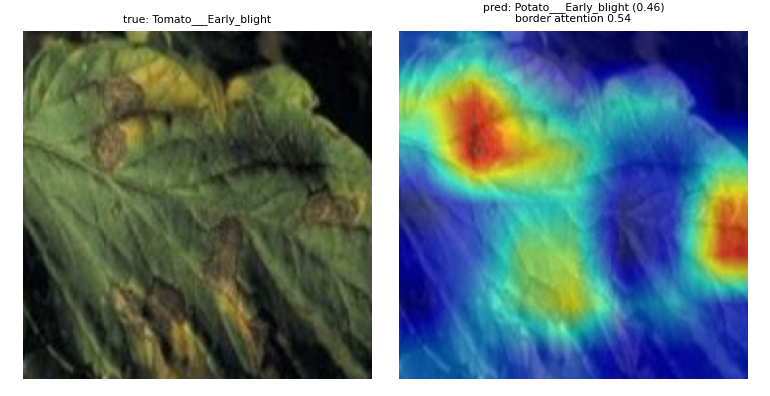

# 🌿 AgriSight: Explainable Early Crop Stress Detection

> **Catch crop stress before it shows.**

[](https://www.python.org/)
[](https://pytorch.org/)
[](https://streamlit.io/)
[](LICENSE)

---

**Event:** AI Innovation Hackathon 2026 — Women in AI Research, Innovation & Entrepreneurship  
**Track:** 1: AI/ML Methodology | **Challenge:** 7: CropVision AI  
**Team:** Shylaja C, Sunandita M

---

## 🔗 Links

| | |
|---|---|
| 🚀 Live Demo | [agrisight-ezyz92pvapp4qnqnt7ztcr.streamlit.app](https://agrisight-ezyz92pvapp4qnqnt7ztcr.streamlit.app/) |
| 🌿 PlantVillage Dataset | [mohitsingh1804/plantvillage on Kaggle](https://www.kaggle.com/datasets/mohitsingh1804/plantvillage) |
| 🌾 PlantDoc Dataset | [andresmgs/plantdec on Kaggle](https://www.kaggle.com/datasets/andresmgs/plantdec) |
| 🎥 Demo Video | `TODO: add YouTube / Drive link` |
| 📓 Kaggle Notebook | `TODO: add Kaggle notebook link` |

---

## 📋 Table of Contents

1. [Problem](#problem)
2. [Solution](#solution)
3. [Key Features](#key-features)
4. [How It Works](#how-it-works)
5. [Results](#results)
6. [Screenshots & Demo](#screenshots--demo)
7. [Quick Start](#quick-start)
8. [Full Reproduction](#full-reproduction)
9. [Repository Structure](#repository-structure)
10. [Limitations](#limitations)
11. [Ethics Note](#ethics-note)
12. [Roadmap](#roadmap)
13. [Credits](#credits)
14. [License](#license)

---

## Problem

Farmers often cannot detect crop disease until symptoms are advanced and yield loss is significant. Professional diagnosis requires expertise that is unavailable in rural areas. AI-based tools promise early detection, but most are built on clean laboratory photos and fail when applied to real field conditions — without ever measuring that failure.

---

## Solution

AgriSight is a research prototype that:

1. Classifies leaf photos into one of 18 predefined crop-stress or disease classes.
2. Shows a Grad-CAM heatmap so users can see where the model looked.
3. Flags predictions below a confidence threshold so users know when to distrust the model.
4. Measures how well a model trained on lab images (PlantVillage) generalises to real field images (PlantDoc) — the *domain gap* — and tests whether field-style data augmentation during training reduces it.

This is a research prototype. It is not a substitute for expert agronomic advice.

---

## ✨ Key Features

- **Multi-model comparison** — Baseline CNN, MobileNetV3-Large, EfficientNet-B0 (optional ResNet50 in code).
- **Two-stage fine-tuning** — frozen backbone → partial unfreeze at lower learning rate.
- **Field-style augmentation** — strong colour jitter, blur, perspective, rotation, random erasing to reduce domain gap.
- **Grad-CAM explainability** — visual explanation of model attention per prediction.
- **Border-attention heuristic** — flags predictions where attention concentrates on the background.
- **Low-confidence warning** — prompts for a better photo rather than a silent wrong answer.
- **Robustness evaluation** — tests each model under simulated dim light, bright light, low contrast, blur, and noise.
- **Domain-gap analysis** — quantifies the accuracy drop from lab to real-field images.

---

## 🔬 How It Works

```
Input leaf photo
       │
       ▼
  Preprocessing (resize 224×224, ImageNet normalisation)
       │
       ▼
  Model inference (baseline CNN / MobileNetV3 / EfficientNet-B0)
       │
       ├─── Softmax probabilities ───► Top-3 classes + confidence
       │
       └─── Grad-CAM ───────────────► Heatmap overlay
                                            │
                                            ▼
                                  Border-attention check
                                  Low-confidence flag
```

**Training pipeline (offline, Kaggle GPU):**

```
PlantVillage (lab images, 38 classes)
       │ filter to 18 shared classes, ≤600 per class
       │ stratified split 70 / 15 / 15
       ▼
  Training set (6,882 images)
       │ class-weighted cross-entropy + label smoothing 0.05
       │ AdamW optimiser, two-stage fine-tuning
       ▼
  Trained checkpoint (.pt)

PlantDoc (real field images, YOLO format)
       │ reorganize_plantdoc.py: crop bounding boxes → class folders
       │ 18 classes, 4,145 images  ← NEVER used for training
       ▼
  External test set
```

---

## 📊 Results

Results are read directly from `results/summary.md`. No values are invented.

| Run | Model | Aug | PV acc | PV F1 | PlantDoc acc | PlantDoc F1 | Gap | Blur acc | Noise acc | Dim-light acc |
|---|---|---|---|---|---|---|---|---|---|---|
| baseline_basic | baseline | basic | 0.909 | 0.910 | 0.063 | 0.060 | 0.845 | 0.277 | 0.455 | 0.198 |
| effnet_field | efficientnet_b0 | field | 0.977 | 0.975 | 0.145 | 0.144 | 0.832 | 0.812 | 0.767 | 0.975 |
| mobilenet_basic | mobilenet_v3 | basic | 0.986 | 0.986 | 0.121 | 0.122 | 0.865 | 0.277 | 0.836 | 0.963 |
| mobilenet_field | mobilenet_v3 | field | 0.978 | 0.979 | 0.160 | 0.169 | 0.819 | 0.778 | 0.884 | 0.973 |

**Key findings:**
- All models achieve high accuracy on PlantVillage (lab) test images.
- All models show a large accuracy drop on PlantDoc (real field) — the domain gap is significant and expected.
- Field-style augmentation (`mobilenet_field`) reduces the domain gap compared to basic augmentation (`mobilenet_basic`): gap narrows from 0.865 to 0.819.
- The field-augmented MobileNet also improves robustness to blur, noise, and dim light.

See confusion matrices in `results/*_plantdoc_cm.png` and Grad-CAM failure examples in `results/*_failures/`. Full analysis: [docs/EVALUATION.md](docs/EVALUATION.md).

---

## 📸 Screenshots & Demo

Explore the AgriSight farmer portal UI and transparent explainability features:

### 1. Hero Landing Page
> Editorial, farmer-first design with transparent research metrics.


### 2. Leaf Photo Input & Inspection
> Multi-modal input options: Choose a file, use live camera, or load built-in demo field leaves.


### 3. Model Transparency & Grad-CAM Visual Evidence
> Real confusion matrix on PlantDoc field evaluation and Grad-CAM attention heatmap analysis:
<p align="center">
  
  
</p>

See [docs/DEMO.md](docs/DEMO.md) for the complete walkthrough and video script.

---

## ⚡ Quick Start

### Prerequisites

- Python 3.10 or later
- Trained model checkpoints in `outputs/` (see [Full Reproduction](#full-reproduction) or download from the Kaggle notebook)

### Install and run

```bash
git clone https://github.com/Shylaja-C/agrisight.git
cd agrisight
pip install -r requirements.txt
streamlit run app.py
```

Then open `http://localhost:8501` in your browser. Upload any leaf photo on the **Scan a Leaf** page.

> **Windows users:** If the app hangs, open `.streamlit/config.toml` and check that the server settings are present.

---

## 🔁 Full Reproduction

Full step-by-step instructions for reproducing every experiment from scratch are in [docs/REPRODUCIBILITY.md](docs/REPRODUCIBILITY.md).

**Summary of steps:**

1. Download datasets from Kaggle (`mohitsingh1804/plantvillage` and `andresmgs/plantdec`).
2. Convert PlantDoc to classification format: `python reorganize_plantdoc.py --yolo_root <path> --output plantdoc_reorganized`
3. Verify class names: `python check_classes.py --pv_root <path> --pd_root plantdoc_reorganized`
4. Prepare splits: `python prepare_data.py --pv_root <path> --pd_root plantdoc_reorganized`
5. Train models (recommended on Kaggle GPU — see the notebook template in `docs/kaggle_notebook_template.md`):
   ```bash
   python train.py --model baseline --aug basic --epochs1 10 --epochs2 0 --run baseline_basic
   python train.py --model mobilenet_v3 --aug basic --run mobilenet_basic
   python train.py --model mobilenet_v3 --aug field --run mobilenet_field
   python train.py --model efficientnet_b0 --aug field --run effnet_field
   ```
6. Evaluate: `python evaluate.py --ckpt outputs/<run>.pt --failures 8`
7. Compare all: `python compare.py`

---

## 🗂 Repository Structure

```
agrisight/
├── app.py                    # Streamlit entry point
├── config.py                 # CLASS_MAP, IMG_SIZE, SEED, MAX_PER_CLASS
├── data.py                   # Dataset class, transforms, perturbations
├── models.py                 # Model definitions, build(), load_checkpoint()
├── train.py                  # Training script (two-stage fine-tuning)
├── evaluate.py               # Evaluation on PV test, PlantDoc, robustness
├── compare.py                # Merge results/*.json → results/summary.md
├── prepare_data.py           # Build data/pv_splits.csv and data/pd_test.csv
├── check_classes.py          # Verify CLASS_MAP against downloaded datasets
├── reorganize_plantdoc.py    # YOLO → classification folder conversion
├── download_datasets.py      # kagglehub download helper
├── gradcam_utils.py          # Grad-CAM overlay and border-attention heuristic
├── styles.py                 # Streamlit CSS injection and UI helpers
├── portal.py                 # Farmer portal UI (optional auth, farm history)
├── pages/                    # Streamlit multi-page app
│   ├── home.py               # Home page
│   ├── scan.py               # Scan a Leaf (inference + Grad-CAM + PDF)
│   ├── trust.py              # Model Trust & Transparency (metrics, charts)
│   ├── compare.py            # Compare Models page
│   ├── myfarm.py             # My Farm (scan history)
│   └── about.py              # About & Ethics
├── data/
│   ├── classes.json          # 18 class names (committed)
│   ├── pv_splits.csv         # PlantVillage split file (gitignored, regenerable)
│   └── pd_test.csv           # PlantDoc test file (gitignored, regenerable)
├── outputs/                  # Trained checkpoints (committed, all < 20 MB)
│   ├── baseline_basic.pt
│   ├── mobilenet_basic.pt
│   ├── mobilenet_field.pt
│   └── effnet_field.pt
├── results/                  # Evaluation outputs (committed)
│   ├── summary.md
│   ├── *.json
│   ├── *_plantdoc_cm.png
│   └── *_failures/
├── docs/                     # Extended documentation
│   ├── ARCHITECTURE.md
│   ├── DATASETS.md
│   ├── MODEL_CARD.md
│   ├── EVALUATION.md
│   ├── DEMO.md
│   ├── ETHICS_AND_LIMITATIONS.md
│   ├── REPRODUCIBILITY.md
│   └── kaggle_notebook_template.md
├── assets/screenshots/       # Screenshots for README and demo
├── requirements.txt
├── packages.txt              # System packages for Streamlit Community Cloud
├── CREDITS.md
├── CITATION.cff
├── LICENSE
└── .gitignore
```

---

## ⚠️ Limitations

- Large lab-to-field domain gap. All models trained on PlantVillage show low accuracy on PlantDoc.
- Only 18 crop-disease classes. Many crops and diseases are not covered.
- PlantDoc test images are bounding-box crops, not whole photos; this affects generalisability.
- Only 11 PlantDoc images for *Potato early blight*, so per-class metrics for that class are unreliable.
- Performance is sensitive to lighting, background clutter, image blur, and crop variety.
- The Grad-CAM border-attention flag is a rough heuristic, not a rigorous diagnostic.

For a full list, see [docs/ETHICS_AND_LIMITATIONS.md](docs/ETHICS_AND_LIMITATIONS.md).

---

## 🛡️ Ethics Note

AgriSight is a **research prototype** designed to study the domain-gap problem in crop disease classification. It is not a certified diagnostic tool. No pesticide or treatment recommendations are given. Users should consult qualified agricultural experts before acting on any output. Uploaded images are not stored by default.

See [docs/ETHICS_AND_LIMITATIONS.md](docs/ETHICS_AND_LIMITATIONS.md) for the full responsible-AI statement.

---

## 🗺️ Roadmap (not built)

These features are planned but not implemented:

- Retrieval-based explanations (show similar training examples).
- Multilingual and voice output.
- WhatsApp / SMS interface for low-connectivity regions.
- Expert-verified, location-aware agronomic context.

---

## 🙏 Credits

See [CREDITS.md](CREDITS.md) for full attributions.

Key sources: PlantVillage dataset (Hughes & Salathé, 2015; Mohanty et al., 2016), PlantDoc dataset (Singh et al., 2020), Grad-CAM (Selvaraju et al., 2017), pytorch-grad-cam (Jacob Gildenblat), MobileNetV3 (Howard et al., 2019), EfficientNet (Tan & Le, 2019), PyTorch, Streamlit, scikit-learn.

Datasets retain their original licenses; see [docs/DATASETS.md](docs/DATASETS.md).

---

## 📄 License

The **code** in this repository is released under the [MIT License](LICENSE) — © Shylaja C, Sunandita M.

The **datasets** (PlantVillage, PlantDoc) are NOT included in this repository and are governed by their own licenses. See [docs/DATASETS.md](docs/DATASETS.md).

---

## 👩‍💻 Team

| Name | Role |
|---|---|
| Shylaja C | Model development, evaluation, explainability |
| Sunandita M | Data pipeline, app development, documentation |
